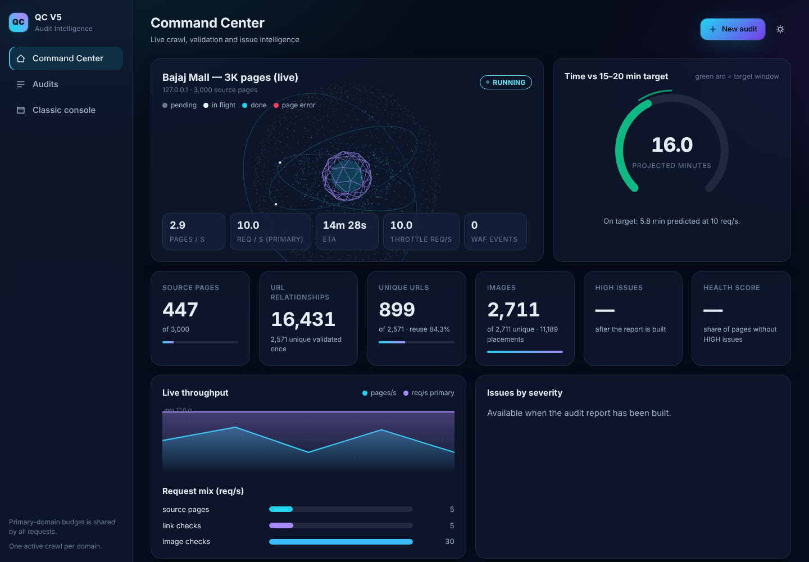

# QC V5 — Website Audit Intelligence

Audit every sitemap page of a large site — every link, canonical, hreflang, iframe and image on it, plus a deep
SEO / technical-SEO and sitemap-health review — validate each unique URL exactly once, and turn the results into a
prioritized, actionable issue report. Built for
**10,000 pages in 15–20 minutes** without tripping the site's WAF.



## Highlights

- **Command Center** (`/dashboard/`): live 3D crawl view, time-vs-target gauge, throughput, smart insights, issue
  explorer, worst pages, one-click reports. Dark and light themes, mobile-ready, accessible.
- **Fast and safe crawling**: one shared request budget per domain (and optional per-host budgets for CDNs),
  adaptive rate control with Akamai cooldowns, SSRF checks on every redirect hop, robots.txt honored.
- **Validate once, keep every relationship**: three-level dedup (same page, across pages, in flight) for links and
  images; a sitemap page linked from other pages is satisfied by its own fetch.
- **Sitemap configuration**: point it at a sitemap, robots.txt or just a domain; it follows sitemap indexes and
  `.gz` files, shows the sitemap tree with per-file health, and lets you pick sitemaps, include/exclude URL patterns
  and a page cap. Save the setup as a **profile** and re-run it any time (each run re-reads the sitemaps).
- **SEO and technical-SEO deep dive** (no extra requests, collected during the same single parse): titles,
  descriptions, H1s, duplicates across pages, noindex/nofollow (meta and `X-Robots-Tag`), canonical placement, meta
  refresh, viewport, `lang`, JSON-LD validity, Open Graph, thin and duplicate content, mixed content, hreflang codes,
  self-reference, x-default and reciprocity, URL hygiene, orphan pages, internal pages missing from the sitemap, and
  sitemap lastmod/duplicate/size checks.
- **Every URL on the page**: links, canonical/hreflang/social/JSON-LD URLs, scripts, stylesheets, icons, CSS `url()`,
  media, embeds and forms (recorded, never requested), each typed and validated once; images also from CSS
  backgrounds, video posters and JSON-LD.
- **Explorers for huge audits**: URL audit, URL detail (HTTP, redirect chain, canonical, robots, metadata, headings,
  structured data, links, images, issues with evidence, raw rows), Link audit, Image audit, Issue explorer — all
  server-side filtered/sorted/paged, rendered in a virtualized grid (300,000 rows → < 80 DOM rows).
- **Issues you can work**: issues persisted and deduplicated (page + rule + subject), lifecycle OPEN → IN_PROGRESS →
  VERIFIED → RESOLVED per project (a re-audit verifies fixes and re-opens regressions), remediation plan generated
  from them, deterministic SEO health score (35/25/20/10/10, `qcv5-health-1.0`).
- **Job lifecycle**: pause, resume, cancel, crash recovery (INTERRUPTED → resume from checkpoint); live progress,
  throughput and ETA come from the backend.
- **Actionable reports**: ~100 issue types with severity and a specific recommended fix, plus per-type and per-page
  summaries; 18 streamed files in one ZIP with a manifest (rows, size, SHA-256 verified against the ZIP).
- **Trustworthy numbers**: a 35-check trust gate reconciles every CSV against the database; any mismatch fails the run.
- **Resumable**: stop and resume any time; API restarts don't interrupt audits.

## Quick start

```bash
./start.sh            # Windows: start.bat — creates a venv, installs requirements + Chromium, starts the server
```

Open <http://127.0.0.1:8002/dashboard/> → **New audit** → **From sitemap** (enter a sitemap, robots.txt or domain →
**Discover sitemaps** → pick sitemaps / patterns), or paste / upload URLs → choose a speed preset (the wizard shows the
predicted duration) → **Launch**. Saved profiles live under **Sitemaps**. The classic console stays at <http://127.0.0.1:8002/>.

Command line (same engine, same reports):

```bash
python run_on_page_audit.py --urls sitemap_urls.txt --job-id onpage_10k --primary-domain bajajfinserv.in \
  --target-rps 12 --max-rps 12 --source-concurrency 20 --dest-concurrency 20 --image-concurrency 30 \
  --host-budget cms-assets.bajajfinserv.in=20 --out-dir reports/onpage
```

Re-run with the same `--job-id` to resume. `--sitemap-meta` (written by the dashboard) adds sitemap provenance for
the sitemap report; `--no-seo` skips the SEO page facts. `python run_on_page_audit.py -h` lists every option.

## Speed: what decides 15–20 minutes

The crawler holds whatever request rate you give it (measured 13.99 of 14.0 req/s), so duration is set by the rate the
target's edge tolerates:

| Primary-domain rate | 10K pages |
|---|---|
| 8 req/s (conservative preset) | ~23 min |
| 12 req/s ("15–20 min target" preset) | ~15 min |
| 14 req/s (fastest stable on the simulated Akamai model) | 13.1 min measured |
| 16 req/s, max 18 (Enterprise 150K preset, simulated edge without WAF) | **11.25 min measured end to end** (crawl 10.8 min + reports/ZIP 24 s) |
| 16 req/s preset on the simulated Akamai model (blocks > 15 req/s) | crawl 13.0 min measured (one WAF cooldown, rate adapted down to ~13.8 req/s); its report build ran before the report-speed fix (538 s), which now takes ~24 s → ~13.5 min |

300,000 pages need ~318K primary requests: **≤ 4 h requires the edge to sustain ≥ 23 req/s** (see the performance
report for the measured 300K run).

Images on a CDN with its own budget run in parallel; images under the same rate-limited domain add ~70 min per 10K
pages. Measure the real ceiling from your network with `bench/live_edge_matrix.py` before raising rates.

## Reports (ZIP)

| File | Contents |
|---|---|
| `01_summary.csv` | Totals, rates, issue counts by severity, reconciliation + integrity status |
| `00_manifest.csv` | Every file: dataset, row count, columns, size, SHA-256, status |
| `17_input_exceptions.csv` | Input lines that are not pages (invalid URL, exact or normalized duplicate) with the reason |
| `12_issues.csv` | One row per problem: severity, type, page, element, URL, anchor/alt, status, detail, **recommended action** |
| `13_issue_summary.csv` · `14_page_issue_summary.csv` | Per issue type (unique URLs, pages affected) · per page, worst first |
| `15_seo_page_audit.csv` | One row per 2xx HTML page: indexability, robots directives, title/description/H1, headings, lang, viewport, structured data, Open Graph, word count, content hash, hreflang, mixed content, link counts |
| `16_sitemap_audit.csv` | One row per sitemap file: fetch status, URLs, duplicates, size, and pages audited / 2xx / redirected / errors / noindex / non-canonical / lastmod problems, health |
| `02`–`10` | Source pages, every link relationship, unique URL validations, every image placement, unique image validations, broken links, redirects, broken images, external links |
| `11_reconciliation.csv` | The 35 trust-gate checks with expected/actual values |

## Documentation

- [Architecture](docs/architecture/ARCHITECTURE.md): components, pipeline, data model, API, lifecycle, issues/score, performance model, security, operations
- [API contract (frozen v1.0)](docs/api/API_CONTRACT.md) + [OpenAPI](docs/api/openapi_onpage.json)
- [Backend audit and gap analysis](docs/audit/BACKEND_AUDIT_AND_GAPS.md)
- [Design system](docs/design/DESIGN_SYSTEM.md): tokens, components, motion, accessibility
- [10K performance and accuracy report](docs/performance/ON_PAGE_10K_URL_IMAGE_AUDIT.md)
- [User guide — Command Center](docs/guides/USER_GUIDE.md): creating audits, live monitoring, explorers, issues, remediation, reports
- [SOP — running an on-page audit](docs/guides/SOP_ON_PAGE_AUDIT.md): pre-flight rate check, procedure, validation, incidents, checklists
- [Classic console user guide](USER_GUIDE.md)

## Project layout

```
server.py                 FastAPI app (classic APIs + /api/on-page/* + static UIs)
onpage_service.py         audit lifecycle, presets/estimates, insights, report access
run_on_page_audit.py      audit worker CLI (engine + CSV/ZIP package)
on_page_audit_engine.py   crawl + validation pipeline, rate control, checkpoints
on_page_issue_rules.py    issue types, severity, recommended actions
on_page_csv_packager.py   streaming reports + trust gate (incl. cross-page SEO + sitemap reports)
seo_audit.py              SEO / technical-SEO page facts and rules
sitemap_config.py         sitemap discovery, selection, saved profiles (builds on sitemap_extractor.py)
html_parser.py · url_normalizer.py · request_errors.py · on_page_schema.py
job_manager.py · daemon.py · checker.py · db.py      classic bulk URL-status pipeline
frontend/dashboard/       Command Center (ES modules, design tokens, vendored Three.js)
frontend/index.html       classic console
bench/                    simulated edge, benchmarks, live-edge RPS matrix
docs/                     architecture, design, performance, reports
test_*.py                 test suites
```

## Testing

```bash
python -m pytest -q --ignore=test_container.py --ignore=test_ex.py --ignore=test_html.py --ignore=test_js.py
```

Key suites: `test_platform_pipeline.py` (deterministic fixture site: every HTTP class, redirects, all URL types,
issues DB + lifecycle, score, manifest, explorers, remediation, pause/resume/cancel, SIGKILL recovery),
`test_security_validation.py` (SSRF, CSV injection, input validation), `test_e2e_platform_ui.py` (Playwright: sitemap
wizard → live audit → explorers → issue lifecycle → remediation → reports, 300K-row grid),
`test_on_page_url_image_audit.py` (extraction, dedup, issues, reports), `test_seo_sitemap_audit.py`
(SEO rules, sitemap discovery/selection/profiles, end-to-end SEO + sitemap reports), `test_onpage_dashboard_api.py`
(service + API end-to-end), `test_dashboard_ui.py` (real-browser UI smoke), `test_url_status_large_volume.py`
(125K URLs). The four ignored files are scratch scripts that browse live sites. In a sandbox without internet/DNS,
17 pre-existing tests fail for that reason alone; they pass where public DNS is available.
