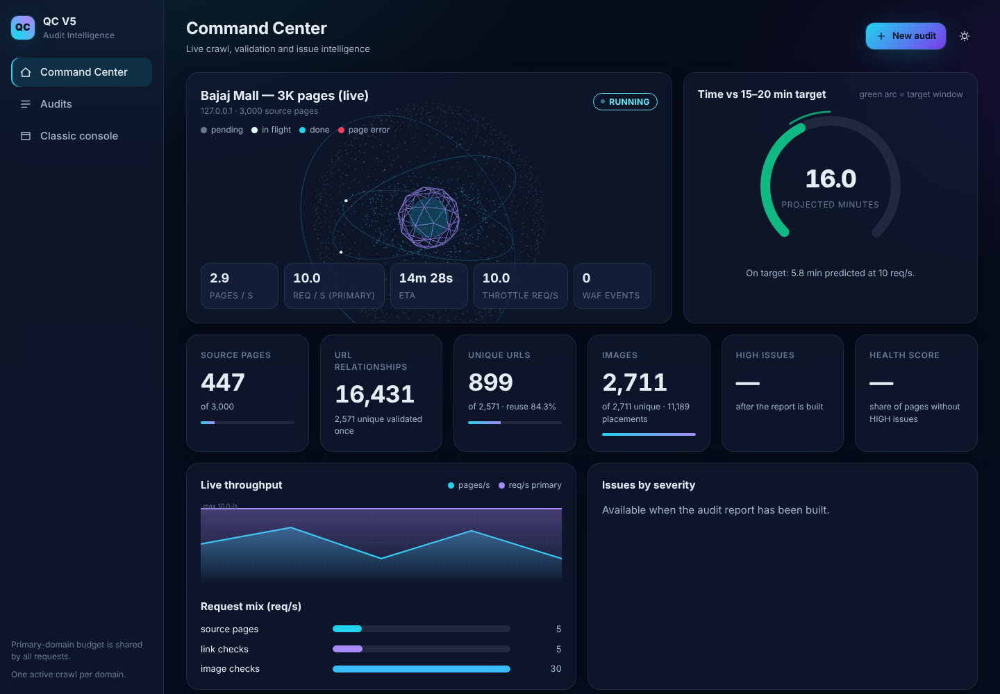
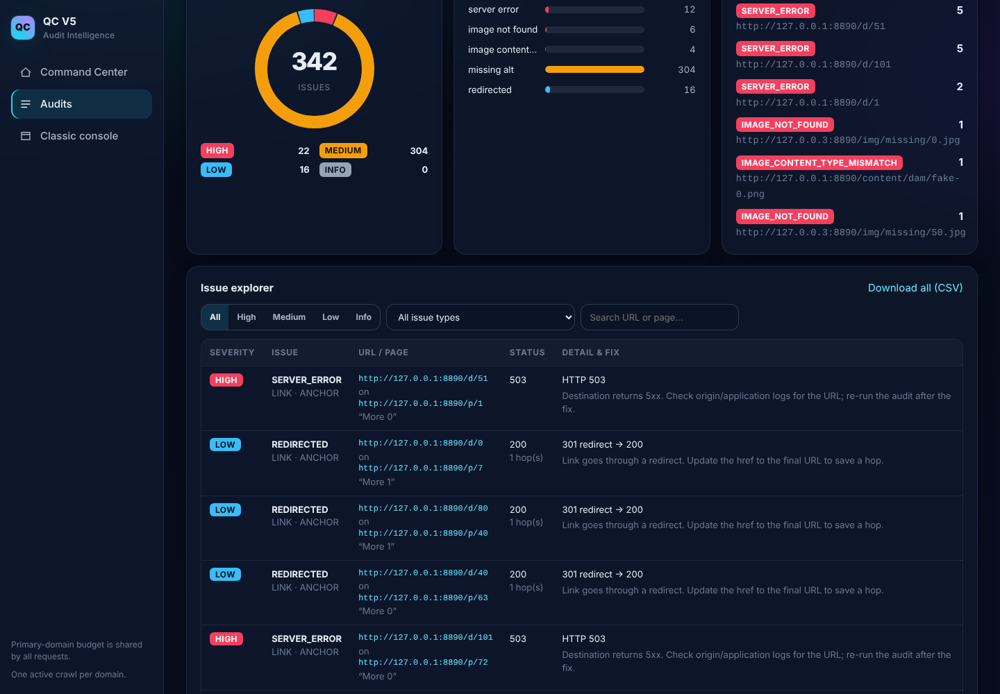
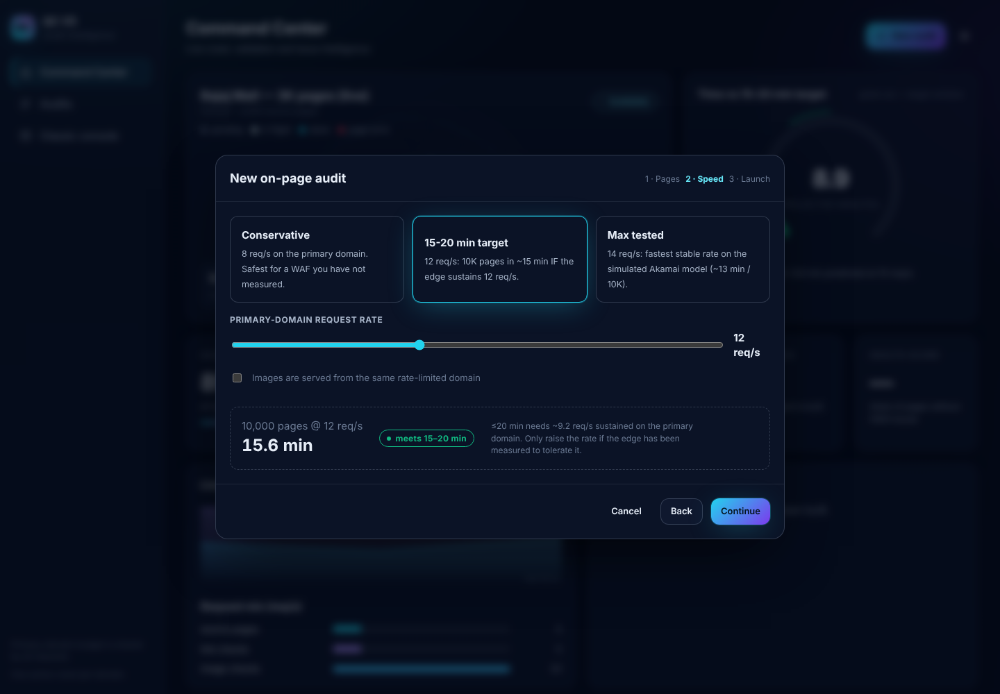
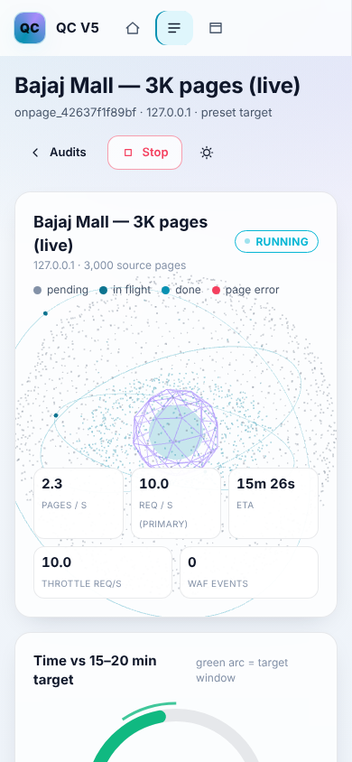

# QC V5 Command Center — Design System

Audience: designers and front-end engineers. Source of truth: `frontend/dashboard/css/tokens.css`.

## Principles

1. **Data first, decoration never.** Every visual encodes something: the 3D core is a progress map, ring speed is
   the request rate, colors are severities. If it doesn't help someone decide what to fix, it doesn't ship.
2. **Fix-first.** Views open on what matters most: HIGH issues, biggest wins, worst pages.
3. **Honest numbers.** Estimates say what they assume; live projections explain gaps (e.g. "50% of the budget is
   validating non-sitemap links"); WAF results are labeled "not the origin's status".
4. **Calm motion.** Short, purposeful, and fully disabled under `prefers-reduced-motion`. Polling refreshes never
   replay entrance animations.

## Tokens

| Group | Tokens | Notes |
|---|---|---|
| Brand | `--brand-500` cyan, `--accent-500` violet | primary actions, progress, data series |
| Severity | `--sev-high` red, `--sev-medium` amber, `--sev-low` sky, `--sev-info` slate | identical meaning in badges, charts, 3D |
| State | `--ok`, `--warn`, `--danger`, `--active` (in-flight) | state pills, 3D in-flight dots |
| Surface | `--bg`, `--bg-elev`, `--glass`, `--glass-strong`, `--stroke` | glass panels over a soft gradient backdrop |
| Text | `--text`, `--text-2`, `--text-3` | primary / secondary / tertiary |
| Type | system UI stack; `--fs-xs` … `--fs-2xl`; tabular numerals for metrics | no web-font download |
| Space / shape | `--s-1` … `--s-8` (4 px grid), `--r-sm/md/lg/pill` | |
| Motion | `--t-fast` 140 ms, `--t-med` 260 ms, `--t-slow` 600 ms, `--ease` | all 0 ms under reduced motion |

Themes: dark (default, "mission control") and light (`[data-theme="light"]`, follows the OS on first visit,
toggle persisted per browser).

## Components

| Component | Use |
|---|---|
| **Crawl Core (3D)** | Each dot ≈ N pages: dim outer shell = pending, bright band = in flight, inner orbit = done (teal clean / red HIGH issue); rings and comets follow req/s; core turns amber on WAF pushback. Drag to rotate. Pauses off-screen; static under reduced motion; text fallback without WebGL. |
| **Target gauge** | Projected or actual minutes on a 0–40 scale with the 15–20 min window marked in green. |
| KPI card | Label, animated value (counts from previous value), sub-text, optional progress bar against its own population. |
| Insight | Icon + title + one-sentence finding; kinds: danger, warning, info, success. |
| Severity donut, bar list, area chart | Dependency-free SVG; animated once per view. |
| Issue explorer | Severity segmented control (opens on HIGH), issue-type select, debounced search, paging; each row shows URL, the page it's on, anchor/alt text, status, hop count, detail and fix. |
| Wizard | Pages (paste or file) → Speed (presets, rate slider, live estimate) → Launch. |
| State pill | RUNNING (pulsing), COMPLETED/PASS, STOPPED/PARTIAL, FAILED. |

## Accessibility

Keyboard reachable (rows are focusable, Enter opens), visible focus rings, `aria-label`s on charts summarizing the
data, skip link, modal with `aria-modal` and Escape to close, live region only for toasts (not for polling
refreshes), color never the only signal (severity text labels everywhere), reduced motion respected.

## Responsive

Breakpoints at 1280 / 1080 / 860 / 640 / 480 px: KPI grid 6 → 3 → 2 columns, side nav becomes a top bar, hero
grows taller and stat chips compact on phones. Verified at 390 × 844 with no horizontal overflow.

## Security rules for UI code

Crawled pages control anchor text, alt text and URLs. All data is inserted with `h()` (text nodes) — never
`innerHTML`. External links open with `rel="noopener noreferrer nofollow"`.
