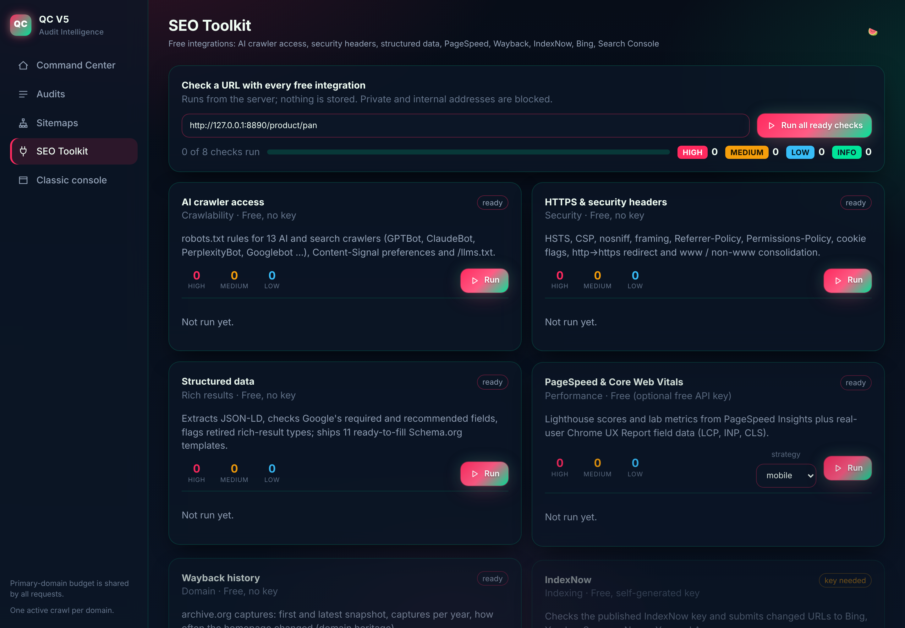

# SEO Toolkit — free integrations

The **SEO Toolkit** (`/dashboard/#/integrations`, or **SEO Toolkit** on any audit's page) runs eight free checks
against one URL and shows a timeline of confirmed Google updates and ready-to-fill Schema.org templates. Every check
runs on the server, nothing is stored, and private / internal addresses are blocked (the same SSRF guard as the
crawler, applied to every redirect hop).



Several checks are ported from **claude-seo** (<https://github.com/AgriciDaniel/claude-seo>, MIT,
© 2026 agricidaniel). The licence and a file-by-file mapping are in `qcv5/integrations/NOTICE.md`.

## The checks

| Check | Cost / key | What it tells you |
|---|---|---|
| **AI crawler access** | Free, no key | robots.txt rules for 13 crawlers (GPTBot, OAI-SearchBot, ChatGPT-User, ClaudeBot, Claude-SearchBot, Claude-User, PerplexityBot, Perplexity-User, Google-Extended, Applebot-Extended, CCBot, Googlebot, Bingbot) evaluated per RFC 9309; which search / AI-answer crawlers are blocked at `/`; Content-Signal preferences; `/llms.txt` presence and format. |
| **HTTPS & security headers** | Free, no key | HSTS (max-age, includeSubDomains, preload readiness), CSP (unsafe-inline / unsafe-eval / wildcards / object-src / base-uri), `X-Content-Type-Options`, framing (CSP frame-ancestors or X-Frame-Options), Referrer-Policy, Permissions-Policy, cookie flags (names only, never values), http → https redirect and www / non-www duplicate hosts. |
| **Structured data** | Free, no key | Every JSON-LD block (including `@graph`): invalid JSON, Google's required and recommended fields per type (Product, Offer, Article, BreadcrumbList, FAQPage, Organization, LocalBusiness, Event, Recipe, VideoObject, JobPosting, Review …), retired rich-result types (ClaimReview, Vehicle Listing, Estimated Salary, Learning Video, Special Announcement), Offer price format, AggregateOffer misuse; counts microdata / RDFa. |
| **PageSpeed & Core Web Vitals** | Free; optional free key | Lighthouse scores (performance, accessibility, best practices, SEO), lab metrics (LCP, CLS, TBT …), real-user field data (CrUX) and the largest savings. Without a key it uses Google's shared quota, which is often used up (shows **Needs key**). |
| **Wayback history** | Free, no key | archive.org captures of the homepage: first and latest snapshot, captures per year and how often the content changed (domain heritage / expired-domain checks). |
| **IndexNow** | Free, self-made key | Checks your published key file and (with `submit=true`) tells Bing, Yandex, Seznam, Naver, Yep and Amazon which URLs changed. Without a key it proposes one and shows where to publish it. |
| **Bing Webmaster Tools** | Free account + API key | Inbound-link counts per page, crawl issues and URL submission quota for a site verified in Bing Webmaster Tools. |
| **Google Search Console + GA4** | Free (service account) | Clicks, impressions, CTR and average position (top 25 queries and pages, last 7/28/90 days), URL Inspection for the URL (index verdict, coverage, Google vs declared canonical) and GA4 sessions by channel. |

Plus, on the same page:

* **Google Search updates** — 66 confirmed updates since March 2024 (core, spam, policy, documentation), each
  linking to a Google-owned source; use it to line up traffic changes with update dates. API:
  `GET /api/integrations/google-updates?since=2025&kind=core&limit=20`.
* **Schema.org templates** — 11 JSON-LD templates (VideoObject, BroadcastEvent, Clip, SeekToAction,
  SoftwareSourceCode, ProductGroup, ProfilePage, Certification, OfferShippingDetails, full e-commerce Product,
  ItemList) with a Copy button. API: `GET /api/integrations/schema-templates`.

**Not included** (listed on the page too): DataForSEO, Ahrefs, Moz, SE Ranking, Profound (paid); Firecrawl and image
generation (credit-based, not auditing); the Common Crawl web graph (multi-GB downloads per query); Matomo, PostHog,
Shopify, YouTube and the Google Ads keyword planner (need their own stack or account).

## Using it

1. Open **SEO Toolkit**, enter a URL (a bare domain works) and press **Run all ready checks**. Cards marked
   **key needed** are skipped until their key is set; you can still press their **Run** button to see setup help.
2. Each card shows HIGH / MEDIUM / LOW counts, the key facts and every finding with a specific fix.
3. Some cards take options: PageSpeed **strategy** (mobile / desktop), Search Console **days** (7 / 28 / 90),
   IndexNow **submit** (false = check only).

## Keys and setup (all free)

Set these as environment variables for the server process (for example in the shell before `python -m qcv5`, or in
your service manager). Keys are read on each run, never returned by the API and never written to logs.

| Variable | For | How to get it |
|---|---|---|
| `PAGESPEED_API_KEY` (or `GOOGLE_API_KEY`) | PageSpeed + CrUX | Google Cloud console → APIs & Services → enable *PageSpeed Insights API* and *Chrome UX Report API* → Credentials → API key. 25,000 PSI requests/day free. |
| `INDEXNOW_KEY` | IndexNow | Any 8–128 characters of `a-z A-Z 0-9 -` (the toolkit suggests one). Publish it as `https://your-site/<key>.txt` containing just the key. |
| `BING_WEBMASTER_API_KEY` | Bing Webmaster | bing.com/webmasters → verify the site → Settings → API access → generate key. |
| `GOOGLE_SERVICE_ACCOUNT_FILE` | Search Console + GA4 | Google Cloud → IAM → Service accounts → create → Keys → add JSON key; save the file on the server and point this variable at it. Enable *Search Console API* (and *Google Analytics Data API* for GA4). |
| `GSC_PROPERTY` | Search Console | The property exactly as in Search Console: `sc-domain:example.com` or `https://www.example.com/`. Add the service account's e-mail as a user of that property (Settings → Users and permissions → Restricted is enough). |
| `GA4_PROPERTY_ID` | GA4 (optional) | GA4 Admin → Property details → numeric ID. Add the service account's e-mail as a Viewer of the property. |

Example (Linux / macOS):

```bash
export PAGESPEED_API_KEY=...            # never commit keys
export INDEXNOW_KEY=3f9c2a7d41e84b6c9d0e1f2a3b4c5d6e
python -m qcv5
```

## API

| Method | Path | Body / query | Returns |
|---|---|---|---|
| GET | `/api/integrations` | — | catalogue: id, name, category, cost, env vars, `configured`, params, `not_included` |
| POST | `/api/integrations/{id}/run` | `{"url": "...", "params": {...}}` | one result (below) |
| GET | `/api/integrations/google-updates` | `since`, `kind`, `limit`, `unverified` | update timeline |
| GET | `/api/integrations/schema-templates` | — | templates with JSON-LD |

Every run returns the same shape:

```json
{"integration": "security_headers", "status": "ok", "target": "https://example.com/",
 "summary": {"https": true, "security_headers_passed": 4, "findings_by_severity": {"HIGH": 0, "MEDIUM": 1, "LOW": 2, "INFO": 1}},
 "findings": [{"id": "hsts-missing", "severity": "MEDIUM", "title": "No Strict-Transport-Security header",
               "detail": "", "fix": "Send 'Strict-Transport-Security: max-age=31536000; includeSubDomains'."}],
 "data": {"...": "check-specific detail"}, "error": null, "source": "...", "checked_at": "...", "duration_ms": 412.3}
```

`status` is `ok`, `error`, `unreachable` (the site could not be fetched or was blocked as private) or `needs_key`.
At most four runs execute at once on a server.

## Verification status

All eight checks, the timeline, templates and the four endpoints are covered by `tests/test_integrations.py`
(14 tests) against simulated responses, including SSRF blocking of a redirect to a private address and keys never
appearing in URLs or responses. Live calls to Google, Bing, IndexNow and archive.org were **not verified** from the
build environment (its network does not allow those hosts, and Google's keyless PageSpeed quota answered 429). The
three no-key checks were run end to end against a local test site in the browser.
