# QC V5 Command Center — User Guide

QC V5 audits every page in a website's sitemaps: every link, canonical, hreflang, script, stylesheet and image on
each page, plus a deep SEO and technical-SEO review. Each unique URL is checked once, and the results become a
prioritized list of issues with a recommended fix for each.

This guide covers the browser app (**Command Center**, `/dashboard/`). For the step-by-step operating procedure
(rate limits, validation, incidents, record keeping) see the [SOP](SOP_ON_PAGE_AUDIT.md).

**Contents**
1. [Getting started](#1-getting-started)
2. [Screen layout](#2-screen-layout)
3. [Create an audit](#3-create-an-audit)
4. [Watch an audit run](#4-watch-an-audit-run)
5. [Audit tabs](#5-audit-tabs) — Overview · URLs · Links · Images · Issues · Remediation · Reports
6. [Working with issues](#6-working-with-issues)
7. [Sitemaps and saved profiles](#7-sitemaps-and-saved-profiles)
8. [Reports and the ZIP package](#8-reports-and-the-zip-package)
9. [Health score](#9-health-score)
10. [Speed, presets and how long an audit takes](#10-speed-presets-and-how-long-an-audit-takes)
11. [Keyboard, themes and accessibility](#11-keyboard-themes-and-accessibility)
12. [FAQ and troubleshooting](#12-faq-and-troubleshooting)
13. [Glossary](#13-glossary)

---

## 1. Getting started

### Install and start (first time)

```bash
git clone https://github.com/shivtej1201/qc_v5.git
```

```bash
cd qc_v5
```

```bash
./start.sh
```

On Windows, double-click `start.bat`. The script creates a Python virtual environment, installs the requirements and
Chromium, and starts the server.

Open **<http://127.0.0.1:8002/dashboard/>** in Chrome, Edge, Firefox or Safari. The classic console (older bulk URL
status checker) stays at <http://127.0.0.1:8002/>.

### Start again later

```bash
source venv/bin/activate
```

```bash
python run.py
```

On Windows: `venv\Scripts\activate`, then `python run.py`. Stop the server with **Ctrl+C**. Running audits are
separate worker processes: stopping or restarting the server does not stop them, and the dashboard picks them up
again when it restarts.

### Requirements

Python 3.10 or newer, 8 GB RAM, and free disk of roughly **75 KB per page** you plan to audit (about 1 GB per
10,000 pages; see the SOP for large audits).

---

## 2. Screen layout

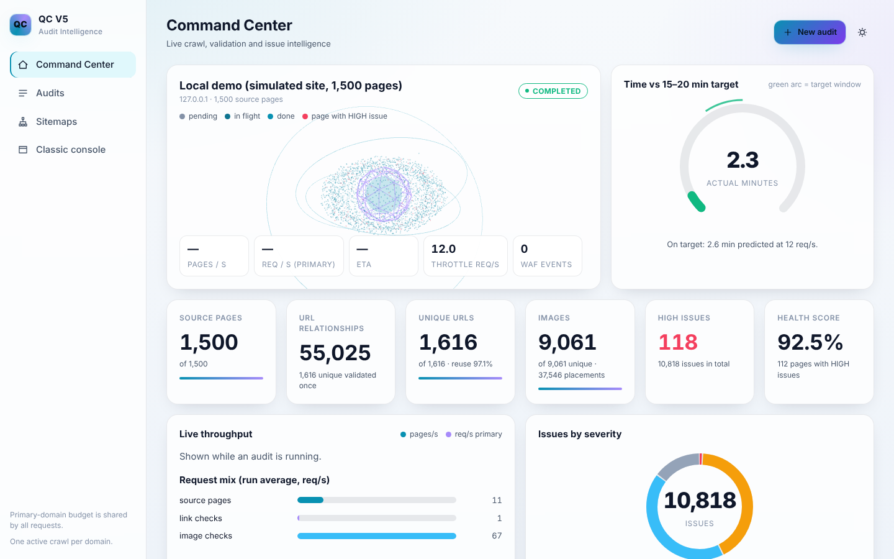

| Area | What it does |
|---|---|
| **Sidebar** | **Command Center** (home), **Audits** (all audits), **Sitemaps** (saved profiles), **Classic console** |
| **Command Center** | The most recent or running audit with its live 3D crawl view, time-vs-target gauge, throughput, smart insights, issues by severity, worst pages and one-click reports |
| **Top right** | **New audit** button and the theme switch (☀ / ☾) |
| **Footer note** | Reminder that all requests to the primary domain share one rate budget, and only one crawl per domain runs at a time |

---

## 3. Create an audit

Click **New audit**. The wizard has three steps: **1 · Pages → 2 · Speed → 3 · Launch**.

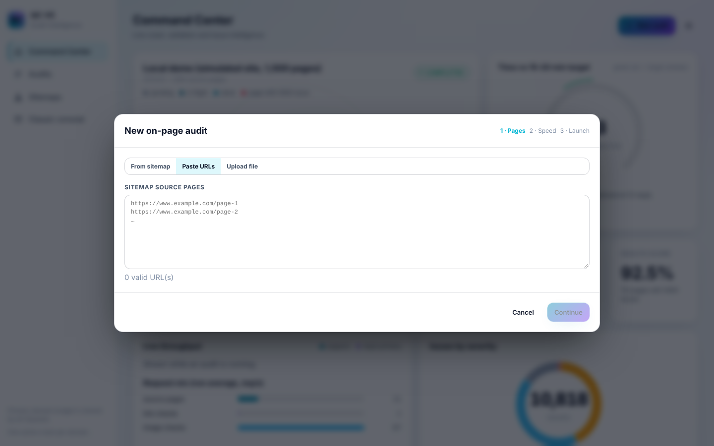

### Step 1 — Pages: choose one of three inputs

**A. From sitemap (recommended)**

1. In *Sitemap, robots.txt or domain* enter one per line, for example:
   * `https://www.bajajfinserv.in/sitemap.xml`
   * `https://www.bajajfinserv.in/robots.txt` (sitemaps listed in it are used)
   * `bajajfinserv.in` (sitemaps are discovered from robots.txt and common locations)
2. Click **Discover sitemaps**. The app follows sitemap indexes and `.gz` files and shows a tree:
   * **INDEX** rows are sitemap indexes, **URLSET** rows contain pages.
   * Per file: HTTP status, URLs listed, unique URLs, duplicates, size, content type, response time, lastmod problems.
   * A **FAILED** file (404, WAF/HTML page instead of XML, invalid XML) is shown, never silently skipped.
3. **Sitemaps to include** — tick the files you want (all by default).
4. Optional filters:
   * **Include URLs matching** — e.g. `/personal-loan/` keeps only matching pages.
   * **Exclude URLs matching** — e.g. `/hindi/` removes matching pages.
   * **Max pages (0 = all)** — cap for a trial run.
5. **Pages selected** shows the result with a sample; pages blocked by robots.txt are excluded by default.
6. Optional: **Save as a reusable sitemap profile**, give it a **Profile name** (e.g. *Loans weekly*). See §7.

**B. Paste URLs** — paste source page URLs, one per line. The counter shows how many are valid.

**C. Upload file** — drop a `.txt`, `.csv` or `.xlsx` file (a column of URLs).

Nothing you supply is lost: invalid lines and duplicates (exact or after normalization, e.g. trailing slash or
upper-case host) are listed in report `17_input_exceptions.csv` with the reason.

Click **Continue**.

### Step 2 — Speed

| Field | Meaning |
|---|---|
| **Audit name** | Shown everywhere; e.g. *Loans – Nov W47* |
| **Primary domain (shared rate budget)** | The site's registrable domain, e.g. `bajajfinserv.in`. All its sub-domains (`www.`, `cms-assets.` …) share one request budget |
| **Speed preset** | See §10. The wizard shows **Predicted @ preset** duration |
| **Requests per second** | Fine-tune the primary-domain rate if your operator agreed a different value |
| **Images are served from the same rate-limited domain** | Tick if images come from the same protected domain; the estimate then includes image requests |

### Step 3 — Launch

Review the summary and click **Launch audit**. The audit opens on its Overview tab.

---

## 4. Watch an audit run

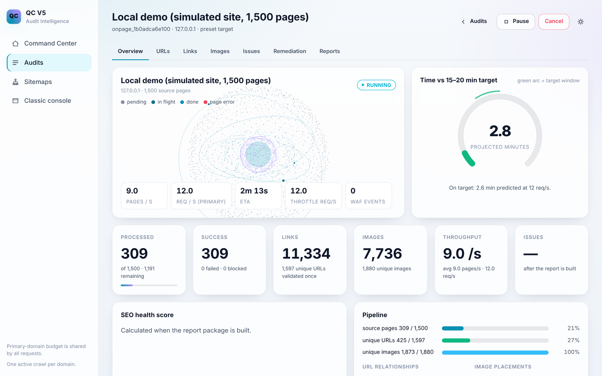

| Element | Meaning |
|---|---|
| **Status pill** | CREATED → QUEUED → RUNNING → COMPLETED. Also PAUSING / PAUSED / RESUMED, CANCELLING / CANCELLED, PARTIAL (finished with some failed pages), FAILED, INTERRUPTED (server/machine stopped mid-run) |
| **3D crawl view** | Every dot is a page: grey pending, blue in flight, teal done, red = page with a HIGH issue. Ring speed follows the live request rate |
| **PAGES / S** | Pages finished per second (live) |
| **REQ / S (PRIMARY)** | Requests per second to the primary domain — should sit at your preset |
| **ETA** | Remaining time, computed by the backend from recent throughput |
| **THROTTLE REQ/S** | The rate the engine currently allows itself; drops after WAF signals |
| **WAF EVENTS** | 403 / 429 / challenge responses. Non-zero → the engine cools down and slows down automatically |
| **Time vs target gauge** | Projected (then actual) minutes against the 15–20 min window for 10K pages |
| **Processed / Success / Links / Images / Throughput / Issues** | Live counters; issues appear once the report is built |
| **Pipeline** | Progress of source pages, unique URLs and unique images |

Controls (top right while running):

* **Pause** — stops gracefully after committing in-flight work. **Resume** continues from the checkpoint.
* **Cancel** — stops for good. Completed data stays viewable but no report is built and it cannot be resumed.

If the server or machine stops, the audit shows **INTERRUPTED** — open it and click **Resume**.

---

## 5. Audit tabs

All lists are **server-side** filtered, sorted and paged, and drawn in a virtualized grid, so even 300,000 rows
scroll smoothly. Click a column header to sort (click again to reverse). **Columns** hides/shows columns (remembered
per browser). Click a row to open its detail.

### Overview

Status, live metrics (§4), and after completion the **SEO health score** with its five dimensions, issue counts by
severity, and pipeline totals. **Download ZIP** appears when the package is ready.

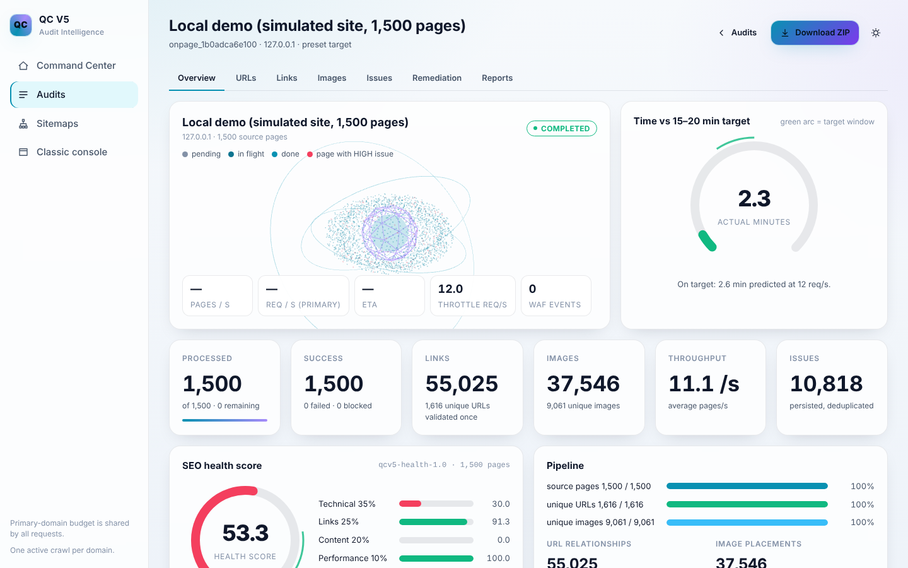

### URLs — one row per sitemap page

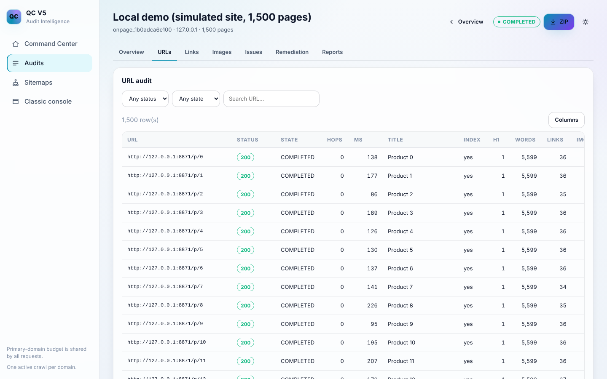

Filters: status class (2xx / 3xx / 4xx / 5xx), crawl state, search. Columns include status, final URL, redirects,
response time, title, link and image counts, business, page type, language, indexable, H1 count, word count.

Click a row for **URL detail**:

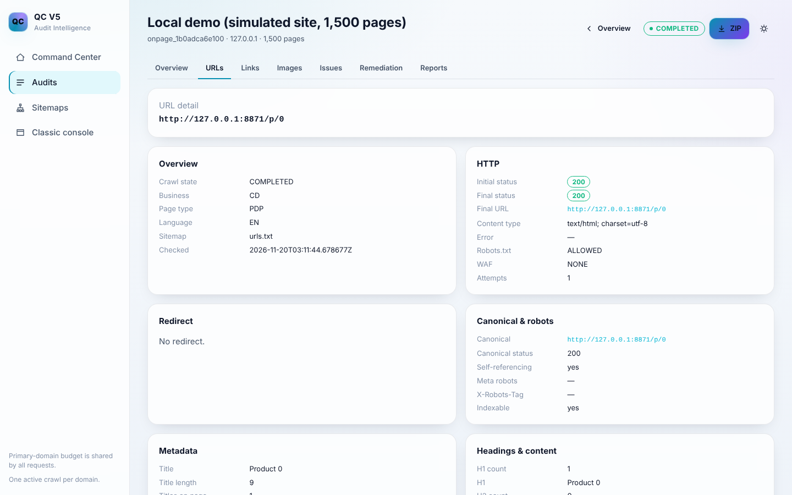

| Section | Contents |
|---|---|
| Overview | Crawl state, business, page type, language, sitemap, checked time |
| HTTP | Initial and final status, final URL, content type, error, robots.txt result, WAF, attempts |
| Redirect | Full chain with each hop's status |
| Canonical & robots | Canonical URL and its status, self-referencing, meta robots, X-Robots-Tag, indexable |
| Metadata | Title (+ length, count), meta description, viewport, lang, Open Graph |
| Headings & content | H1 count / text, H2–H6, heading-level skips, word count, content hash |
| Hreflang · Structured data | Language alternates; JSON-LD types and validity |
| Links · Images | Counts by URL type; image placements, missing alt, broken |
| Issues | Every issue on the page with evidence |
| Raw | The stored database rows, for support |

### Links — every page → URL relationship

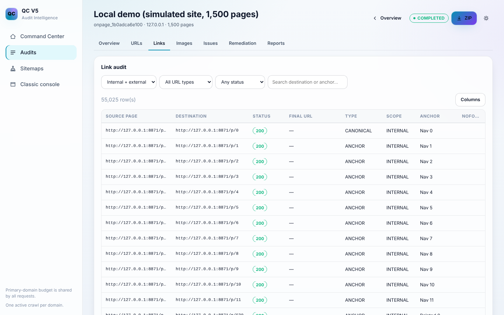

Covers every URL found on a page, not only `<a>` links:

| URL type | Examples |
|---|---|
| Navigation | `ANCHOR`, `AREA`, `IFRAME`, `META_REFRESH` |
| SEO signal | `CANONICAL`, `HREFLANG`, `SOCIAL_URL` (og:url, twitter:url), `JSONLD_URL` |
| Resource | `SCRIPT`, `STYLESHEET`, `LINK_RESOURCE` (icon, manifest, preload), `CSS_RESOURCE`, `MEDIA`, `EMBED` |
| Form | `FORM` — recorded with its method but **never requested** (no form is ever submitted) |

Filters: scope (internal / external / non-HTTP), URL type, status class, source page, search. **Business, page type
and language come from the source page**, so you can filter broken links by business line.

### Images — every image placement

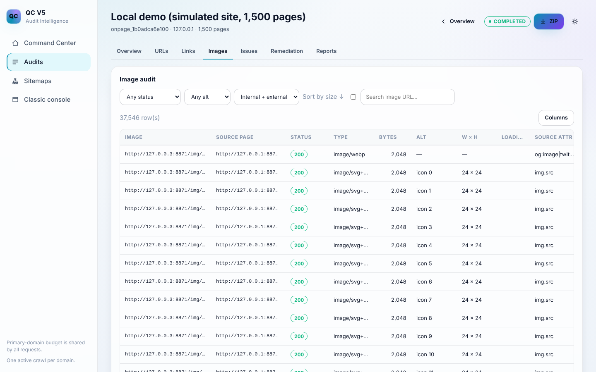

Images from ``, `srcset`, `<picture>`, lazy-load attributes (`data-src` …), CSS backgrounds, video posters,
Open Graph and JSON-LD. Filters: internal/external, status class, alt text (missing / empty / present), source page.
Columns include status, content type, size, width/height, format, lazy-loading and the image issue.

### Issues

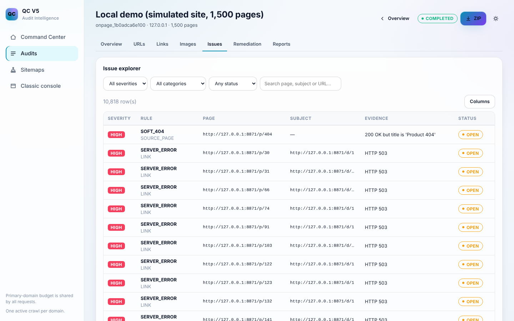

See §6.

### Remediation — the fix plan

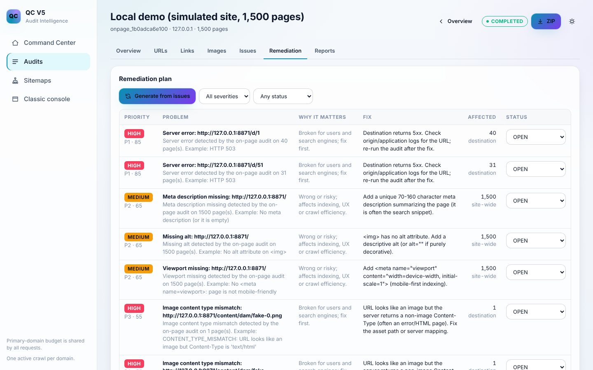

Click **Generate from issues**. Issues are grouped into work items:

* a broken / redirecting **destination** becomes one item listing every page that links to it;
* a **page** problem becomes one item per page, or one **site-wide** item when more than 25 pages share it (usually a
  template fix).

Each item has priority (P1–P3) and score, problem, why it matters, the fix, the number affected, and a status
(OPEN, IN_PROGRESS, VERIFIED, RESOLVED, DISMISSED, NEEDS_REVIEW) you can change in place. Filter by severity or status.

### Reports

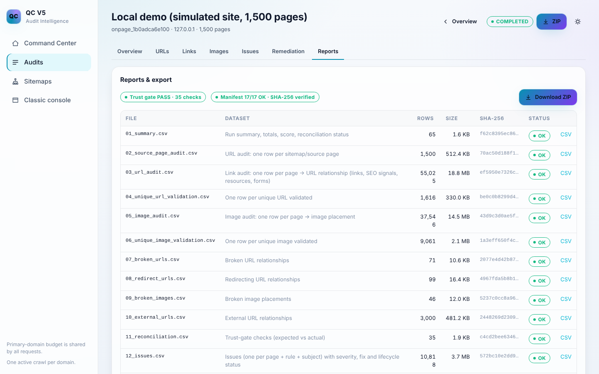

* **Trust gate** badge — `PASS · 35 checks` means every CSV was reconciled against the database.
* **Manifest** badge — every file's row count and SHA-256 verified against the ZIP.
* Table of all files: dataset description, rows, size, checksum, status, and a **CSV** link to download one file.
* **Download ZIP** — everything in one archive. See §8.

---

## 6. Working with issues

Every issue is unique per **page + rule + subject** (the subject is the broken URL, image, canonical target …).
Re-building a report never duplicates issues.

**Filter and search** by severity (HIGH, MEDIUM, LOW, INFO), category (e.g. SOURCE_PAGE, LINK, IMAGE, RESOURCE,
ON_PAGE_SEO, CONTENT, TECH_SEO, CANONICAL, HREFLANG, URL_STRUCTURE, SITEMAP), status, or text (page, subject or URL).

**Open an issue** (click the row):

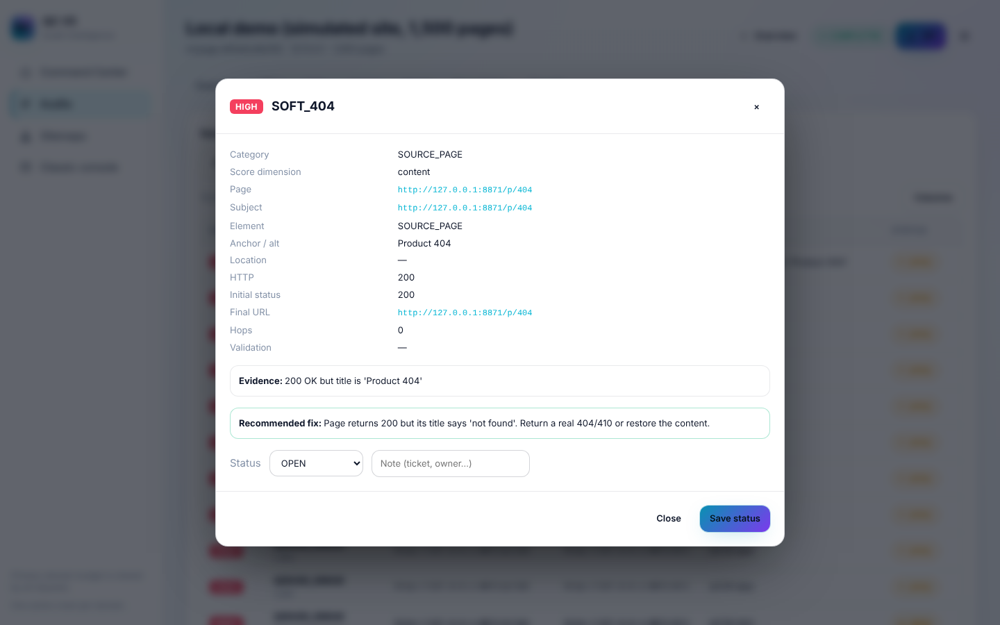

* Category, score dimension, page, subject, element, anchor / alt text, location, HTTP status, initial status, final
  URL, hops, validation source.
* **Evidence** — exactly what was detected (e.g. *200 OK but title is 'Product 404'*).
* **Recommended fix** — a specific action.
* **Status** + **Note** (ticket number, owner) → **Save status**.

**Issue lifecycle (per project = primary domain)**

| Status | Set by | Meaning |
|---|---|---|
| OPEN | system | Detected and not yet handled |
| IN_PROGRESS | you | Someone is fixing it |
| VERIFIED | system | A later audit of the same domain no longer detects it, and its page was audited successfully |
| RESOLVED | you | Fix confirmed and closed |
| DISMISSED | you | Deliberate exception (e.g. intended noindex); not reopened by you, still reported |

A VERIFIED or RESOLVED issue that is detected again in a later audit is **re-opened automatically** (regression), and
the summary counts it under *issues_reopened_regressions*.

Common HIGH issues: `NOT_FOUND`, `GONE`, `CLIENT_ERROR`, `SERVER_ERROR` (broken destinations), `SOFT_404` (a 200 page
that looks like an error page), `REDIRECT_LOOP`, `REDIRECT_TO_BROKEN`, `NOINDEX_IN_SITEMAP`, `SOURCE_*` problems on
the sitemap page itself (`SOURCE_NOT_FOUND`, `SOURCE_WAF_BLOCKED` …), broken images and image URLs that do not return
an image (`IMAGE_CONTENT_TYPE_MISMATCH`, `IMAGE_NOT_AN_IMAGE`). The Issues tab lists about 100 rule types. Pages that look like JavaScript-only app shells are flagged
`JS_RENDERING_SUSPECTED` (they are checked over HTTP, not rendered).

---

## 7. Sitemaps and saved profiles

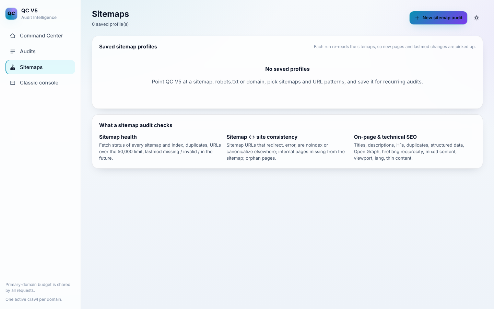

A **profile** stores the sitemap inputs, selected sitemaps, include/exclude patterns, page cap, preset and primary
domain. Under **Sitemaps** you can:

* **Run now** (▶) — re-reads the sitemaps (new pages are picked up, removed ones dropped) and launches a new audit.
* **Review & run** — opens the wizard pre-filled so you can check the sitemap tree and change selections; tick
  **Update the saved profile** to keep the changes.
* **Delete profile** (bin icon) — removes the profile; audits already run are kept.
* **New sitemap audit** (+) — starts the wizard on the *From sitemap* input.

Use one profile per recurring scope, e.g. *Loans weekly*, *Insurance monthly*. Re-running the same profile is how
fixes get **VERIFIED** (§6).

---

## 8. Reports and the ZIP package

| File | Contents |
|---|---|
| `00_manifest.csv` | Every file: dataset, rows, columns, size, SHA-256, status |
| `01_summary.csv` | Totals, rates, issue counts by severity, health score, reconciliation and integrity status |
| `02_source_page_audit.csv` | URL audit: one row per sitemap page (status, redirects, canonical, robots, title, description, H1, word count, link counts …) |
| `03_url_audit.csv` | Link audit: every page → URL relationship (type, rel, nofollow, hreflang, status, business, page type, language) |
| `04_unique_url_validation.csv` | One row per unique URL validated |
| `05_image_audit.csv` | Image audit: every page → image placement (alt, size, format, lazy, status, business, page type) |
| `06_unique_image_validation.csv` | One row per unique image validated |
| `07_broken_urls.csv` · `08_redirect_urls.csv` | Broken / redirecting link relationships |
| `09_broken_images.csv` · `10_external_urls.csv` | Broken image placements · external link relationships |
| `11_reconciliation.csv` | The 35 trust-gate checks (expected vs actual) |
| `12_issues.csv` | One row per issue: severity, type, page, element, URL, anchor/alt, statuses, detail, **recommended action**, issue key, status |
| `13_issue_summary.csv` · `14_page_issue_summary.csv` | Per issue type (pages affected, unique URLs) · per page, worst first |
| `15_seo_page_audit.csv` | One row per 2xx HTML page: indexability, robots, title/description/H1, headings, lang, viewport, structured data, Open Graph, word count, hreflang, mixed content |
| `16_sitemap_audit.csv` | One row per sitemap file: fetch status, URLs, duplicates, size, pages audited / 2xx / redirected / errors / noindex / non-canonical, lastmod problems |
| `17_input_exceptions.csv` | Input lines that are not audited pages, with the reason |

Opening in Excel: **Data → From Text/CSV**, encoding UTF-8. Large files (e.g. `03_url_audit.csv` on big sites can have
millions of rows, beyond Excel's 1,048,576-row limit) are better filtered in the Links tab, or opened with a database
tool or Python. Cells beginning with `= + - @` are prefixed with `'` to block spreadsheet formula injection.

Reports are stored on the server under `reports/onpage/`.

---

## 9. Health score

A deterministic 0–100 score (formula `qcv5-health-1.0`), shown on Overview and in `01_summary.csv`:

| Dimension | Weight | Driven by |
|---|---|---|
| Technical | 35 % | Problems of the page itself, technical SEO, canonicals, hreflang, URL structure, sitemap issues |
| Links | 25 % | Links, resources, images, iframes, form and metadata URLs that are broken, redirected or erroring |
| Content | 20 % | On-page SEO and content: titles, descriptions, headings, thin / duplicate content, missing alt, soft 404 |
| Performance | 10 % | Slow responses, redirect chains, large images, truncated pages, JavaScript-rendered pages |
| Security | 10 % | Mixed content, insecure HTTP links, SSL errors, unsafe destinations |

In each dimension every audited page gets a penalty = the sum of its issue weights there (HIGH 1.0, MEDIUM 0.5,
LOW 0.2, INFO 0), capped at 1. Dimension score = 100 × (1 − average penalty); overall = the weighted sum. The same data always gives the same score; the formula version and calculation time are stored with
it, so scores of different audits are comparable.

---

## 10. Speed, presets and how long an audit takes

The site's edge (CDN / WAF) decides how fast an audit can go: QC V5 holds whatever rate it is given (30 req/s
measured) and backs off by itself on WAF signals. Each page costs about 1.08 requests to the primary domain.

| Preset | Rate | 10K pages | Use when |
|---|---|---|---|
| Conservative | 8 req/s (up to 10) | ~23 min | First run on a site, unmeasured WAF |
| 15–20 min target | 12 req/s | ~15 min | Edge measured clean at ≥ 15 req/s |
| Max tested | 14 req/s | ~13 min | Edge measured clean at ≥ 18 req/s |
| Enterprise 150K | 16 req/s (adaptive to 18) | ~11 min (measured) | Large audits; edge measured clean at ≥ 20 req/s |

Rule of thumb: **minutes ≈ pages × 1.08 ÷ req/s ÷ 60 + 0.5 min per 10K pages for reports.** 300,000 pages in under
4 hours needs about 23 req/s or more.

Never raise the rate above what your operator measured (SOP §6) — blocked requests make the audit slower, not faster,
and can get the audit machine blocked.

---

## 11. Keyboard, themes and accessibility

| Key | Action |
|---|---|
| Tab / Shift+Tab | Move between controls; grids and tabs are focusable |
| ↑ / ↓ | Move the highlighted row in a grid |
| Enter | Open the highlighted row's detail |
| Esc | Close a dialog |

* Theme switch (☀ / ☾, top right): light or dark; the choice is remembered.
* Animations are switched off when your system asks for reduced motion.
* Grids, tabs and dialogs carry ARIA roles; status is never shown by colour alone (text labels on every pill).
* Works on desktop, tablet (1024 px) and phone widths.

---

## 12. FAQ and troubleshooting

| Question / symptom | Answer |
|---|---|
| "Launch" says the domain is already crawling (409) | Only one audit per domain runs at a time. Wait, or pause the other audit |
| WAF events keep increasing | Pause, tell the operator; re-run at a lower preset (SOP §9.2) |
| Status INTERRUPTED | The server or machine stopped. Open the audit → **Resume** |
| Status PARTIAL | Some pages failed / timed out / were blocked. URLs tab → filter crawl state to see which; resume or re-audit them |
| Audit FAILED with "disk is full" | Free disk (old report folders under `reports/onpage/`), then **Resume** |
| Issue count is "—" | Issues are counted when the report package is built, at the end of the run |
| A sitemap shows FAILED | The file returned an error, a WAF/HTML page or invalid XML. Its pages are not audited; report it to the site owner |
| My local test site is refused | Private and loopback addresses are blocked on purpose (SSRF protection). Only for testing on your own machine: start the server with `ALLOW_LOCAL_TESTING=true` |
| A form URL shows "NOT_REQUESTED" | Forms are recorded but never submitted or requested — by design |
| A page is flagged JS_RENDERING_SUSPECTED | The HTML is an app shell with almost no content; its content is rendered by JavaScript, which this audit does not execute |
| Can I trust the numbers? | Yes, when the Reports tab shows **Trust gate PASS · 35 checks** and **Manifest OK** |
| Where is the API documentation? | [API contract](../api/API_CONTRACT.md) and [OpenAPI](../api/openapi_onpage.json) |

---

## 13. Glossary

| Term | Meaning |
|---|---|
| Source page | A sitemap page that is fetched and parsed |
| Destination / found URL | A URL found on a source page |
| Relationship | One source page → found URL pair (a URL used on 500 pages = 500 relationships, 1 validation) |
| Normalized URL | URL after case, default-port, trailing-slash and tracking-parameter clean-up; used for deduplication |
| Validation source | NEW_CHECK (fetched for the first time in this audit), REUSED (already checked — the result is shared; the detail says whether it came from the cache, an in-flight request or the URL's own sitemap fetch), NOT_REQUESTED (forms) |
| Primary domain | The audited site; all its hosts share one request budget |
| WAF | Web application firewall (e.g. Akamai) that can block fast clients |
| Trust gate | 35 checks reconciling every report against the database |
| Manifest | List of report files with row counts and SHA-256 checksums |
| Issue key | Stable id of an issue (hash of page + rule + subject) |
